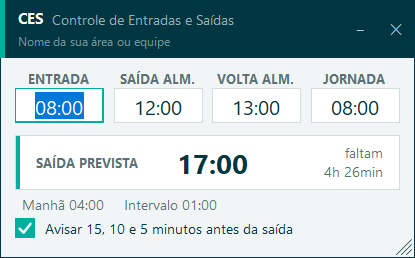
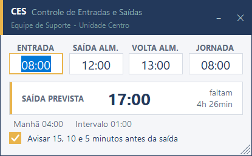

# CES - Controle de Entradas e Saídas

Calculadora de horário de saída para quem precisa cumprir a jornada sem entrar em hora extra.
Você informa a entrada, a saída e a volta do almoço e a carga horária do dia; o programa mostra
a que horas a jornada se completa e avisa antes de o horário chegar.



A janela fica sempre visível sobre as outras, ocupa pouco espaço e pode ser minimizada ou
fechada a qualquer momento. Arrastando o canto inferior direito ela aumenta e diminui, de 60% a
200% do tamanho padrão, com as letras acompanhando a mesma proporção.

Um executável de menos de 50 KB, sem instalador, que não acessa a rede e não pede permissão de
administrador. O código-fonte inteiro está aqui, compila com o que já vem no Windows, e há
scripts para qualquer pessoa conferir o que o binário é capaz de fazer.

## Download

Baixe o `CES-<versão>.zip` na página de
[releases](https://github.com/juniormarorganista/CES-Controle-Entradas-Saidas/releases). O pacote
traz o `CES.exe` e dois arquivos de instruções escritos para quem não é da área:
[COMO-USAR.txt](docs/COMO-USAR.txt), com o uso do dia a dia, e
[COMO-AJUSTAR.txt](docs/COMO-AJUSTAR.txt), com o que a pessoa consegue mudar tendo apenas o
executável, sem acesso ao código.

Quem preferir não rodar um executável baixado pode gerar o próprio (seção
[Gerando o executável](#gerando-o-executável)). Para montar o mesmo pacote a partir do código:

```powershell
powershell -ExecutionPolicy Bypass -File build\empacotar.ps1
```

Sai um `dist\CES-<versão>.zip` com o executável e as instruções, pronto para mandar por e-mail,
chat ou pasta de rede a quem vai usar.

## Instalação

Não há instalador. Copie o `CES.exe` para uma pasta qualquer (a Área de Trabalho serve) e dê
dois cliques.

Se quiser que ele abra junto com o Windows, pressione `Win + R`, digite `shell:startup` e
copie um atalho do `CES.exe` para a pasta que abrir.

### O aviso azul do Windows

Na primeira execução o Windows provavelmente vai mostrar uma tela azul dizendo
"O Windows protegeu o computador". Isso acontece com qualquer programa sem certificado digital
pago e não indica problema com o arquivo. Clique em **Mais informações** e depois em
**Executar assim mesmo**.

Se o antivírus da empresa bloquear o arquivo, o programa não acessa rede e não lê nem grava
nada fora da pasta de configuração do usuário; o código-fonte inteiro está neste repositório
para conferência.

## Personalize para a sua equipe

O topo da janela vem com um texto de exemplo, **"Nome da sua área ou equipe"**, que existe para
ser trocado. Esse texto, o título ao lado da sigla e todas as cores mudam num arquivo de texto,
sem compilar nada.



| O que muda | Onde | Chave |
|---|---|---|
| Nome da área, equipe ou empresa (segunda linha do topo) | `estilo.ini` | `origem` |
| Título ao lado da sigla CES (primeira linha do topo) | `estilo.ini` | `assinatura` |
| Cor principal: barra de cima, borda, horário da saída | `estilo.ini` | `principal` |
| Cor de realce: risco lateral, campo em foco, caixa marcada | `estilo.ini` | `realce` |
| Fundo, campos, contornos, textos, avisos | `estilo.ini` | `fundo`, `cartao`, `borda`, `textoForte`, `textoSuave`, `textoClaro`, `atencao`, `critico` |
| Intervalo mínimo de almoço | `preferencias.ini` | `intervaloMinimo` |
| Horários, jornada, tamanho e posição da janela | na própria janela | o programa guarda sozinho |

Passo a passo:

1. Abra o CES uma vez e feche. Isso cria os dois arquivos.
2. Pressione `Win + R`, digite `%APPDATA%\CES` e Enter. Entre na pasta da versão, por exemplo
   `1.5.0`.
3. Abra o `estilo.ini` no Bloco de Notas e troque o que vem depois do sinal de igual:

   ```ini
   assinatura=Controle de Entradas e Saídas
   origem=Equipe de Suporte - Unidade Centro
   ```

4. Salve e abra o CES de novo.

Linha errada é ignorada e usa o valor padrão, então o programa nunca deixa de abrir por causa
do arquivo. Para voltar ao original, apague o `estilo.ini`: ele é recriado na próxima abertura.

O que cada cor pinta, uma paleta completa de exemplo e o que só muda no código (tamanho das
letras, textos dos avisos, desenho do ícone) estão em [PERSONALIZAR.md](PERSONALIZAR.md).

## Como usar

Os quatro campos são preenchidos com horários no formato `HH:MM`:

| Campo | O que é |
|---|---|
| Entrada | hora em que você começou o expediente |
| Saída alm. | hora em que saiu para o almoço |
| Volta alm. | hora em que voltou do almoço |
| Jornada | carga horária do seu contrato, normalmente `06:00` ou `08:00` |

O quarto campo é o que mais confunde. Ele não é um horário, é a duração da jornada. Com entrada
às 08:00 e jornada de 08:00 os dois campos mostram o mesmo número por coincidência, o que à
primeira vista parece um horário repetido.

O resultado aparece em destaque, junto com o tempo que ainda falta. Abaixo dele o programa
mostra quanto você já trabalhou de manhã e o tamanho do intervalo, e sinaliza quando alguma
coisa não fecha (intervalo curto demais, volta do almoço antes da saída, e assim por diante).

### Digitação

Não é preciso digitar os dois pontos. Digitando `853` o campo completa `08:53`, porque um
algarismo de 3 a 9 só pode ser hora de um dígito. Já `1230` vira `12:30`, porque `1` ainda pode
ser o começo de `12`.

As horas `00`, `01` e `02` são o único caso ambíguo: depois do `1` não há como o programa saber
se você quis dizer `01:xx` ou `1x:xx`. Nesses casos digite os quatro algarismos (`0123` para
01:23) ou use os dois pontos (`1:23`), que continuam aceitos.

Sair do campo completa o que faltar com zeros: `8` vira `08:00`, `85` vira `08:50`.

| Tecla | Efeito |
|---|---|
| `Tab` ou `Enter` | vai para o próximo campo |
| Seta para cima / para baixo | soma ou subtrai um minuto |
| `Delete` | limpa o campo |

## Avisos e alarmes

Três avisos aparecem antes do fim da jornada, aos 15, aos 10 e aos 5 minutos. Cada um surge em
uma faixa no alto da tela que some sozinha depois de alguns segundos, sem tirar o foco do que
você estiver fazendo. Um clique fecha a faixa antes disso.

No horário da saída o programa toca um alarme e mostra uma faixa vermelha informando que dali
em diante o tempo conta como hora extra. Há ainda dois alarmes ligados ao almoço: um na hora
marcada para sair e outro na hora marcada para voltar.

A caixa de seleção na parte de baixo da janela desliga **apenas** os três avisos de 15, 10 e 5
minutos. O alarme da saída continua tocando, já que é a razão de o programa existir, e os dois
do almoço também - não há como desligá-los sem fechar o programa. Quando a saída e a volta do
almoço têm o mesmo horário, os dois viram um alarme só naquele momento.

### Som e volume

Os toques saem do esquema de sons do próprio Windows. Isso quer dizer que eles acompanham o
volume do sistema e podem ser abaixados ou silenciados como os de qualquer outro programa, o
que importa em sala compartilhada.

A contagem dos minutos toca uma batida e os alarmes do almoço e da saída tocam duas, para dar
para distinguir sem olhar para a tela. O toque acompanha a faixa: começa quando ela aparece e
para quando ela sai, seja pelo tempo esgotado ou por um clique.

Para trocar o som em si, abra o Painel de Controle, vá em **Som** e depois na guia **Sons**. A
contagem usa o evento *Exclamation* e os dois alarmes usam *Critical Stop*. Dependendo de como
o Windows foi instalado, esses nomes aparecem traduzidos como *Exclamação* e *Parada Crítica* -
vale conferir, porque a tradução vem da instalação e não acompanha o idioma da interface.

### Quando o alarme não toca

Os horários têm uma tolerância de dois minutos. Passado esse tempo o marco é considerado
perdido e o toque não sai. É o que evita que abrir o programa no fim da tarde dispare de uma
vez o alarme do almoço e o da saída.

A mesma regra vale com o programa já aberto: se a máquina estiver suspensa, ou a tampa
fechada, no horário da saída e só voltar mais de dois minutos depois, o alarme não toca. Nesse
caso nada se perde do cálculo, apenas do som - o estado aparece na janela, em vermelho, com o
tempo excedente.

## Onde ficam as configurações

Dois arquivos de texto, dentro de uma pasta com o número da versão:

```
%APPDATA%\CES\1.5.0\preferencias.ini
%APPDATA%\CES\1.5.0\estilo.ini
```

`preferencias.ini` guarda os horários do dia, a jornada, o intervalo mínimo, o tamanho e a
posição da janela e a opção de avisos. Os horários só são restaurados se o arquivo for do mesmo
dia, então cada dia começa com os valores padrão; o resto vale para sempre.

`estilo.ini` guarda as cores e os textos do topo. É criado sozinho na primeira execução, com os
valores padrão e comentários explicando cada um (seção
[Personalize para a sua equipe](#personalize-para-a-sua-equipe)).

### Por que a pasta tem o número da versão

Cada versão lê e escreve na própria pasta. Uma versão nova nunca começa herdando ajuste feito em
outra, o que garante que mudança de aparência ou de texto padrão apareça de fato, em vez de
ficar mascarada por um arquivo antigo. Voltar para uma versão anterior também funciona: a pasta
dela continua onde estava, intacta.

O efeito prático é que ao atualizar o programa você refaz o que tinha personalizado. Para
aproveitar o que já tinha, copie os arquivos da pasta antiga para a nova antes de abrir,
lembrando que assim você leva junto os valores antigos de `assinatura` e `origem`, e que um
arquivo de versão anterior à 1.5.0 usa outros nomes para as duas primeiras cores
([CHANGELOG.md](CHANGELOG.md)).

Para começar do zero, feche o programa e apague a pasta da versão: ela é recriada na próxima
abertura.

## Requisitos

Windows 10 versão 1903 ou mais novo, ou Windows 11. O programa usa o .NET Framework 4.8, que já
faz parte do sistema nessas versões. Nada precisa ser instalado.

## Gerando o executável

O compilador usado acompanha o próprio Windows, então não é preciso instalar Visual Studio nem
SDK. Um comando faz tudo, da verificação ao pacote pronto:

```powershell
powershell -ExecutionPolicy Bypass -File build\gerar-tudo.ps1
```

A verificação roda antes da compilação e cobre as regras de cálculo, o preenchimento automático
dos horários, o disparo dos avisos e a leitura dos dois arquivos de configuração. Nada nela lê
o relógio nem o disco, então o resultado é o mesmo em qualquer dia e em qualquer máquina.
Depois de compilar, a auditoria confere o binário gerado e interrompe a geração se encontrar
capacidade sensível nele.

O passo a passo, onde mexer para mudar cada coisa e o que fazer quando algo dá errado estão em
[COMPILAR.md](COMPILAR.md). Para aparência, veja antes [PERSONALIZAR.md](PERSONALIZAR.md):
cores e os textos do topo mudam por arquivo, sem compilar.

## Segurança

[SEGURANCA.md](SEGURANCA.md) traz a análise do que o executável é capaz de fazer, extraída dos
metadados do próprio binário, com instruções para qualquer pessoa reproduzir a verificação em
vez de confiar no documento. É o material para levar à área de tecnologia antes de distribuir o
programa em máquina corporativa.

Duas conferências independentes, que não pedem confiança em nada escrito aqui:

```powershell
powershell -ExecutionPolicy Bypass -File testes\auditar.ps1
powershell -ExecutionPolicy Bypass -File testes\reproduzir.ps1
```

A primeira lista tudo o que o binário é capaz de chamar e falha se encontrar capacidade
sensível. A segunda recompila o código-fonte e compara o código intermediário método a método,
que é o que demonstra que o executável entregue saiu deste repositório - o hash sozinho não
mostra isso, porque muda a cada compilação.

## Como o horário de saída é calculado

Partindo de entrada `e`, saída para o almoço `s`, volta do almoço `v` e jornada `j`, o tempo
trabalhado antes do intervalo é `s - e`, e o que resta cumprir depois dele é `j - (s - e)`.
A saída, portanto, é

```
saída = v + (j - (s - e))
```

Com 08:00, 12:00, 13:00 e jornada de 08:00: a manhã rende quatro horas, restam quatro, e a saída
fica às 17:00.

Quando não há intervalo (`s` e `v` iguais) a expressão se reduz a `e + j`, que é o resultado
esperado. Se a manhã já cobrir a jornada inteira, o programa usa `e + j` e avisa que a jornada
se completou antes do almoço.

O intervalo mínimo considerado é de uma hora, configurável pela chave `intervaloMinimo` do
arquivo de preferências. Ele não entra na conta da saída; serve apenas para sinalizar quando o
intervalo informado está abaixo do mínimo.

## Estrutura do repositório

```
src/           código-fonte em C#
build/         compilação, ícone, empacotamento
testes/        verificação, auditoria e reprodução do binário, teste de som
dist/          executável gerado
docs/          instruções para quem usa e imagens desta página
COMPILAR.md      como gerar o executável depois de alterar o código
PERSONALIZAR.md  cores, nome da área e demais ajustes de aparência
SEGURANCA.md     o que o binário é capaz de fazer, e como conferir
CHANGELOG.md     o que mudou em cada versão
```

## Licença

MIT. O texto completo está em [LICENSE](LICENSE).

Projeto pessoal, sem vínculo institucional. Sugestões e correções são bem-vindas pelas
[issues](https://github.com/juniormarorganista/CES-Controle-Entradas-Saidas/issues).
